# asciidoc-productivity — Reference

VS Code extension `schletz.asciidoc-productivity`: editor commands for AsciiDoc and Markdown, LLM commands, source copying, PDF export and a live preview.
Paths are relative to the repository root. User-facing strings are English, except two QuickPick descriptions in German.
Facts marked "(per user)" come from the author and cannot be derived from the code.
Read the diagrams first.

## Purpose

- **Markup commands** (AsciiDoc and Markdown, syntax chosen per document): insert clipboard as source block or table, insert images from file, clipboard or URL with a document-relative path, insert an explorer file as source block, copy a selected table as TSV, convert selected lines to a table. Markdown only: align the table under the cursor.
- **LLM commands**: translate the selection, replace the selection with the answer to a preset or custom system prompt, rewrite whole files. Endpoints: OpenAI-compatible chat completions or the native Anthropic Messages API.
- **Copy sources**: bundle selected files and folders into one XML or Markdown text for an LLM chat or NotebookLM.
- **PDF export** of `.adoc` files with asciidoctor-pdf in Docker.
- **Live preview** of AsciiDoc in a webview: asciidoctor.js, PlantUML via a local Kroki container, highlight.js, MathJax.
- **Must work 100 % offline** (per user). All browser libraries and fonts therefore live in `lib/`; PlantUML rendering uses a local Docker container. Online services may be used when the internet is available, but nothing may depend on them: the preview uses kroki.io only to bridge the time until the local container runs.

## Diagrams

Legend: class diagrams — solid arrow = holds an instance (constructor), dashed = creates or calls, dotted triangle = implements.
Component diagrams — solid = data from writer to file and from file to reader, dashed = call.
An element marked **D** (class spot with the diagram name as stereotype, or "D name:" in a component) is detailed in that diagram.
`globals.ts` (`sourceTypes`, extension → language id) is used by `insertFileAsSourceBlock` and `copySourcesToClipboard` and not drawn.

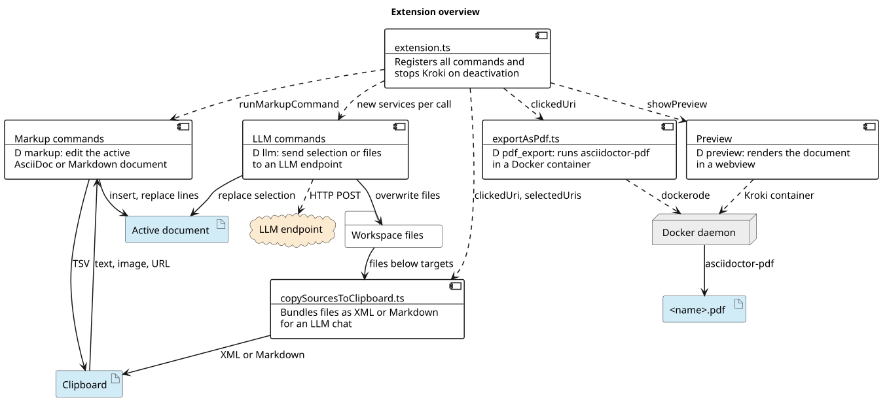

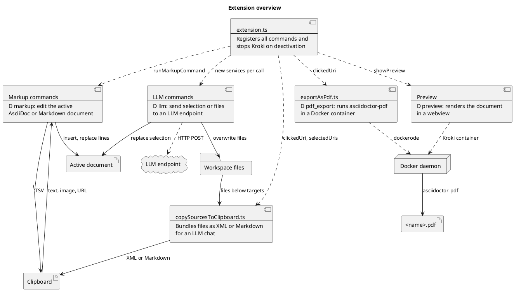

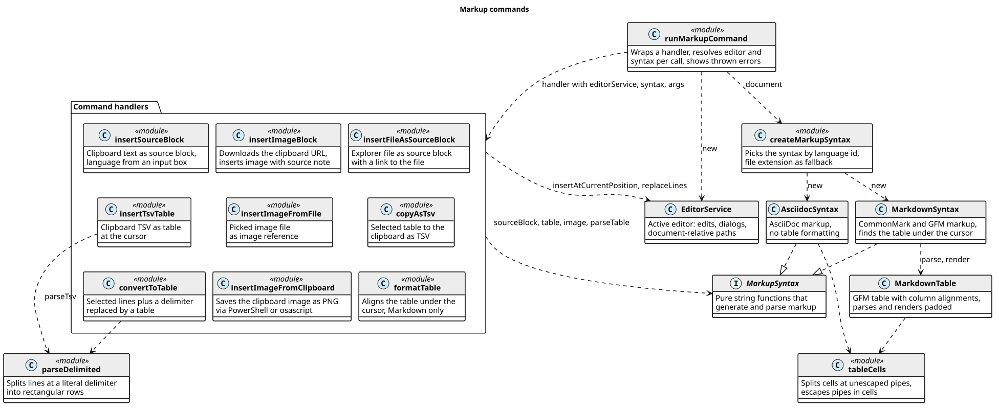

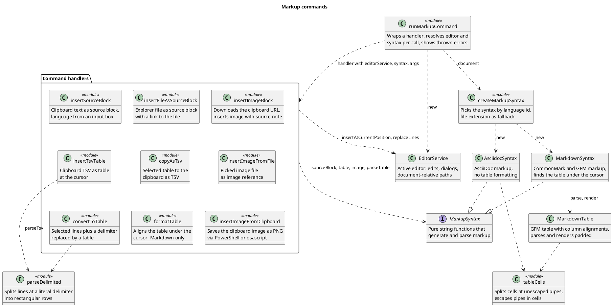

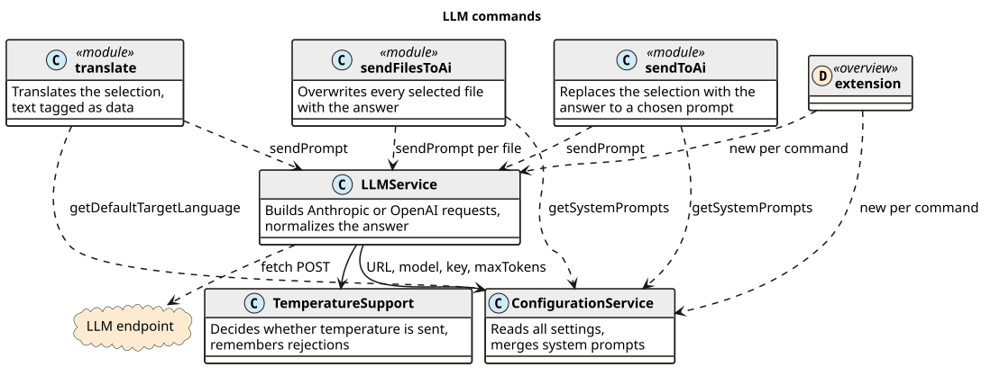

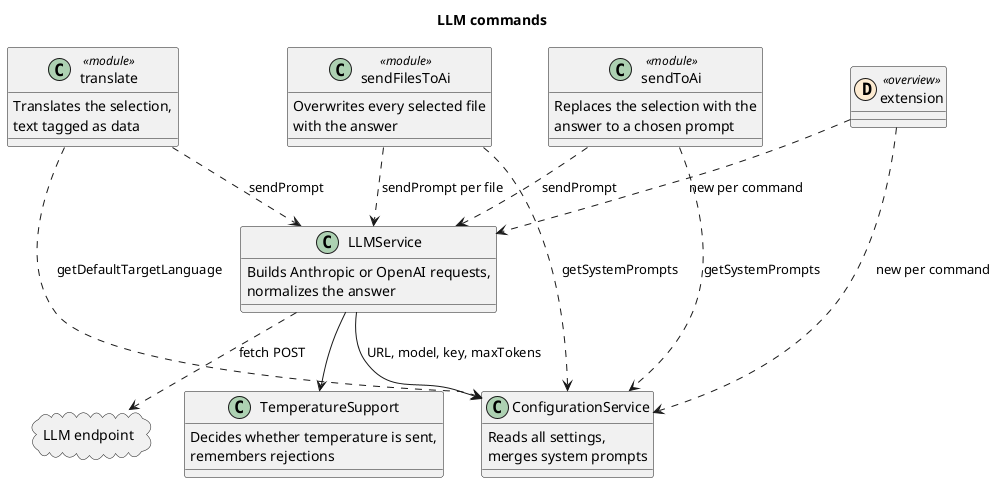

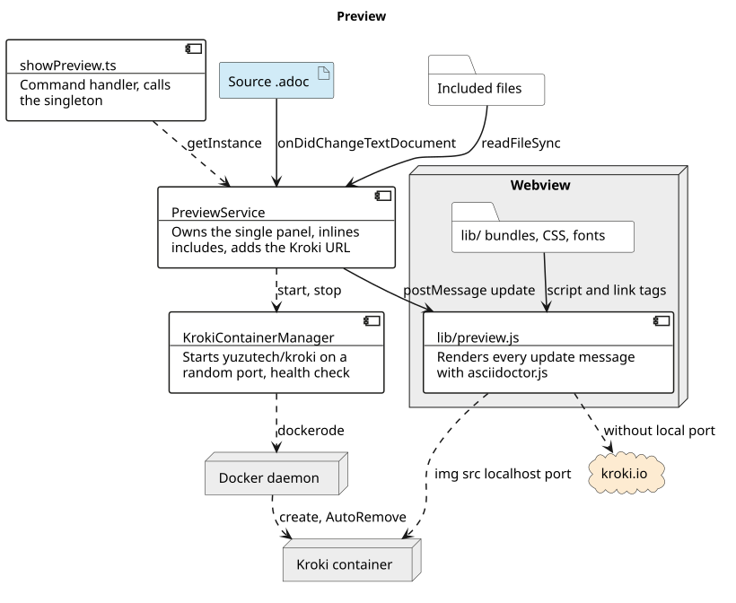

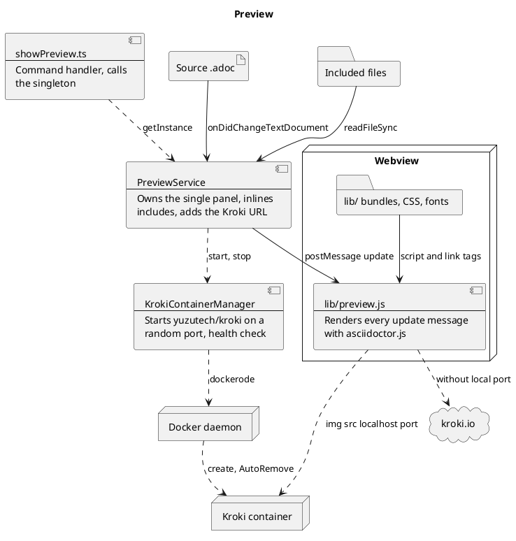

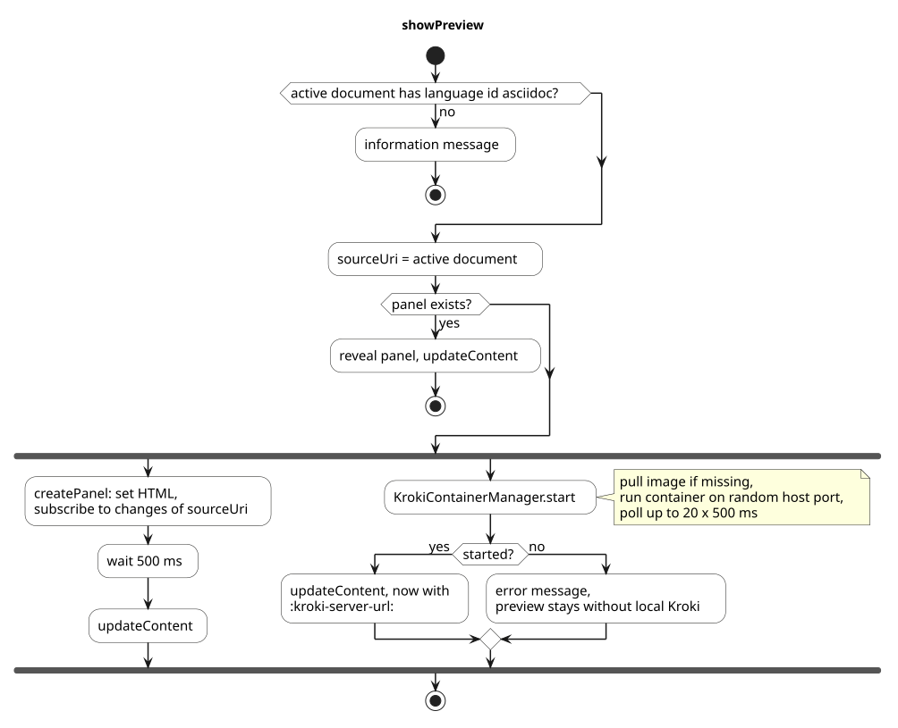

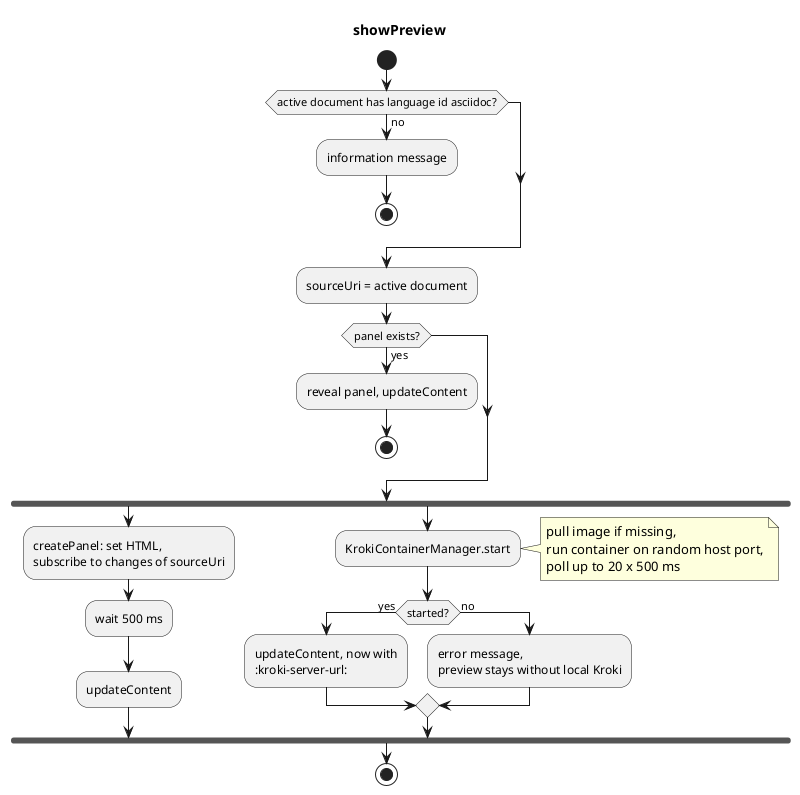

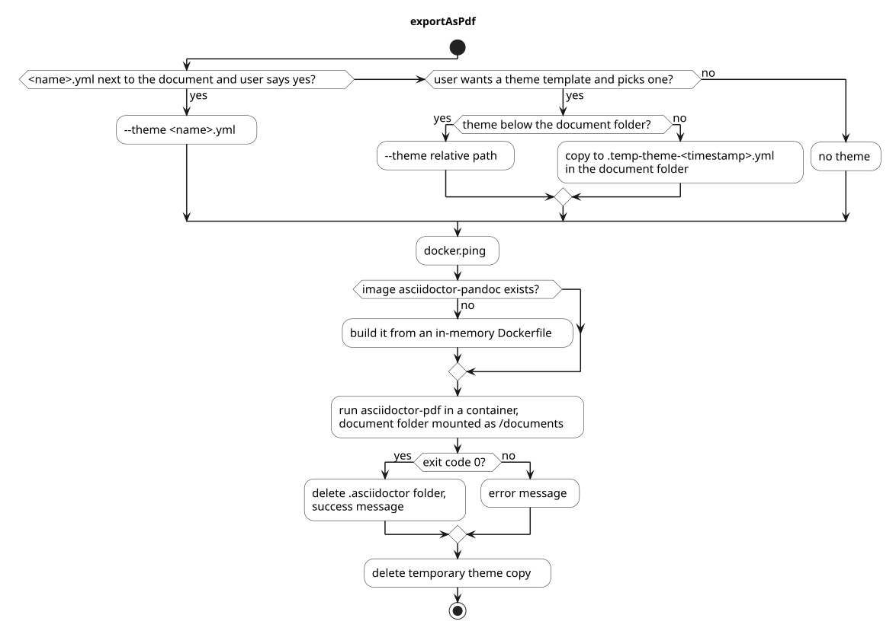

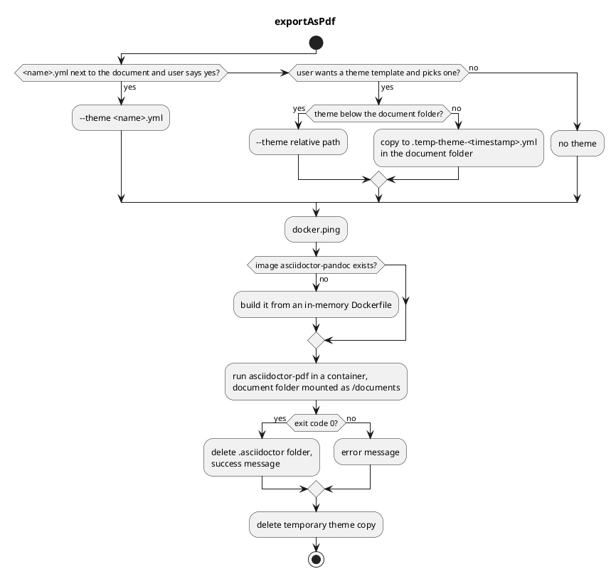

## Contracts and file formats

### Commands

All ids carry the prefix `asciidoc-productivity.`. Activation is implicit through `contributes.commands` (`activationEvents` is empty).
In the command palette every command is visible; markup commands then report an error in other documents.
Explorer commands receive `(clickedUri, selectedUris)`; from the palette both are undefined.

| Id | Handler file | Menu, `when` | Input → output |
| --- | --- | --- | --- |
| insertSourceBlock | insertSourceBlock.ts | editor/context, *markup* | clipboard + input box (default `csharp`) → source block |
| insertTsvTable | insertTsvTable.ts | editor/context, *markup* | clipboard TSV → table |
| insertImageBlock | insertImageBlock.ts | editor/context, *markup* | URL in clipboard → save dialog → download → image with source note |
| insertImageFromFile | insertImageFromFile.ts | editor/context, *markup* | open dialog → image |
| insertImageFromClipboard | insertImageFromClipboard.ts | editor/context, *markup* | save dialog (png) → PNG written → image |
| copyAsTsv | copyAsTsv.ts | editor/context, *markup* | selected table → TSV in clipboard |
| formatTable | formatTable.ts | editor/context, `editorLangId == markdown \|\| resourceExtname =~ /^\.(md\|markdown)$/i` | cursor line → table lines replaced |
| convertToTable | convertToTable.ts | editor/context, `editorHasSelection && (`*markup*`)` | selected lines + delimiter → table replaces the lines |
| translate | translate.ts | editor/context, `editorHasSelection` | selection → translation replaces selection |
| sendToAi | sendToAi.ts | editor/context, `editorHasSelection` | selection → answer replaces selection |
| insertFileAsSourceBlock | insertFileAsSourceBlock.ts | explorer/context | file → source block in the active editor |
| copySourcesToClipboard | copySourcesToClipboard.ts | explorer/context, view/title of the explorer (icon) | selection → clipboard, optional file |
| sendFilesToAi | sendFilesToAi.ts | explorer/context | selection → every file overwritten with the answer |
| exportAsPdf | exportAsPdf.ts | explorer/context, `resourceExtname == .adoc` | `<name>.adoc` → `<name>.pdf` in the same folder |
| showPreview | showPreview.ts | editor/title, `editorLangId == asciidoc` (icons in media/) | webview beside the editor |

*markup* = `editorLangId =~ /^(asciidoc|markdown)$/ || resourceExtname =~ /^\.(adoc|asciidoc|asc|md|markdown)$/i`.
The extension list repeats `asciidocExtensions`/`markdownExtensions` in createMarkupSyntax.ts; the extension fallback matters because without an AsciiDoc extension installed `.adoc` opens as `plaintext`.
The preview, in contrast, requires the language id `asciidoc`, i.e. an installed AsciiDoc language extension.

### Settings

Section `asciidoc-productivity`. Every default is declared twice: in package.json (`contributes.configuration`) and as fallback in the getter of `ConfigurationService`.

| Key | Default | Notes |
| --- | --- | --- |
| includeExtensions | pipe list of all `sourceTypes` keys | regex for copySourcesToClipboard, prefilled in the filter UI; whitespace removed. Must equal the key set of `sourceTypes` (not derived) |
| excludeDirectories | `["bin","obj","node_modules"]` | directory names, case-insensitive |
| excludeFiles | `["package-lock.json"]` | file names, case-insensitive |
| completionsUrl | `http://localhost:1234/v1/chat/completions` (LM Studio) | full path for OpenAI dialect, base URL ending in `/v1/` for Anthropic |
| llm | `lmstudio-community/Qwen3.6-35B-A3B-GGUF` | model id |
| maxOutputTokens | 4096 | `max_tokens` |
| apiKey | `""` | Bearer token or `x-api-key` |
| systemPrompts | three built-in prompts | see `getSystemPrompts` |
| defaultLanguage | `en-US` | prefilled target language of translate |

### LLM wire formats

Dialect: host contains `anthropic.com` → Anthropic, otherwise OpenAI (also for an unparsable URL).

| | Anthropic | OpenAI-compatible |
| --- | --- | --- |
| URL | `new URL('messages', base)` | `completionsUrl` unchanged |
| Auth | `x-api-key`, `anthropic-version: 2023-06-01` | `Authorization: Bearer <key>`, without key `Bearer EMPTY` |
| System prompt | field `system` | message with `role: system` |
| Content | all `text` blocks joined, trimmed | `choices[0].message.content`, trimmed |
| Truncated | `stop_reason === 'max_tokens'` | `finish_reason === 'length'` |
| Usage | `usage.input_tokens/output_tokens` | `usage.prompt_tokens/completion_tokens` |

`temperature` is omitted when `TemperatureSupport` says so. Requests have no timeout and no retry other than the temperature retry.

LM Studio (default `completionsUrl`) serves both `/v1/chat/completions` and `/v1/messages`; both dialects work with it, but a localhost URL always selects the OpenAI dialect. To exercise the Anthropic dialect locally, redirect `fetch` from `https://api.anthropic.com/v1/` to `http://localhost:1234/v1/` (as `MockLlmServer.interceptAnthropic` does). Reasoning models (e.g. Qwen 3.6) spend output tokens on thinking in the OpenAI dialect, which the content excludes; a small `maxOutputTokens` can then yield an empty, truncated answer.

### Copy sources output

Root = first workspace folder (else the parent of the first target); paths relative to it with `/`, files outside it by base name only. `language` = `sourceTypes[ext] ?? ext`. Nothing is escaped (`]]>` or a code fence inside a file breaks the structure).

```xml
<?xml version="1.0"?>
<documents root="asciidoc-productivity" created="2026-11-01T10:00:00.000Z">

<file path="src/parseTsv.ts" language="typescript">
<![CDATA[
...content...
]]>
</file>

</documents>
```

Markdown: `# <root>`, `Created: <ISO>`, then per file `## File <path>` and a ```` ```<language> ```` fence.

### Webview message

`PreviewService` → `lib/preview.js`: `{ command: 'update', text }`, where `text` is the full document with includes inlined and `:kroki-server-url:` inserted. There are no messages in the other direction.
The page defines `printRawHtml` (from the constant in PreviewService.ts) and `window.MathJax` in inline scripts before the libraries load.

### Docker

| Use | Image | Container |
| --- | --- | --- |
| Preview | `yuzutech/kroki:latest`, pulled if `inspect` fails, never updated | port 8000/tcp → random host port (`HostPort: '0'`), `AutoRemove`; one per panel |
| PDF export | `asciidoctor-pandoc`, built locally: `FROM asciidoctor/docker-asciidoctor` + `apk add pandoc` (pandoc is not invoked) | `Binds: <document folder>:/documents`, `AutoRemove`, logs demuxed into the output channel |

asciidoctor-pdf command: `asciidoctor-pdf [--theme X] -r asciidoctor-mathematical -r asciidoctor-diagram -a allow-uri-read -a stem -a mathematical-format=svg -o <name>.pdf <file>`.
dockerode connects to the default local socket or named pipe.

### Bundled libraries (lib/)

Not edited by hand. `preview.js` and `preview.css` are the extension's own files; everything else is vendored so the preview works offline (per user).

| File | Content, origin (per user) |
| --- | --- |
| asciidoctor.min.js | Asciidoctor.js 3.0.4, built from source with one patch, see below |
| asciidoctor-kroki.js | `dist/browser/asciidoctor-kroki.js` of asciidoctor/asciidoctor-kroki; sets `window.AsciidoctorKroki`; default server `https://kroki.io` |
| highlight.min.js | highlight.js 11.11.1 from highlightjs.org/download |
| vs.min.css, vs2015.min.css | highlight.js themes for light and dark VS Code themes |
| tex-mml-chtml.js | MathJax 4 from `https://cdn.jsdelivr.net/npm/mathjax@4/tex-mml-chtml.js` |
| fonts/ | Noto Serif, M+ 1mn (asciidoctor-pdf default theme fonts), Font Awesome solid for admonition icons |

Rebuilding asciidoctor.min.js (per user): clone `https://github.com/asciidoctor/asciidoctor.js`, `npm install` in the root and in `packages/core`, then in `packages/core/src/template-asciidoctor-browser.js` replace `export default function Asciidoctor(moduleConfig)` with `window.Asciidoctor = function Asciidoctor(moduleConfig)`, so the webview can use it as a classic script.

### Repository layout

| Path | Content |
| --- | --- |
| src/ | extension sources; src/test/{unit,e2e,helpers} tests |
| lib/ | webview files, see above |
| media/ | title bar icons of showPreview |
| docs/ | rendered diagrams of this file |
| dist/ | webpack bundle (`main` of package.json), gitignored |
| out/ | tsc output for tests, gitignored |
| `asciidoc-productivity-<version>.vsix` | packaged extension; only the current version is committed |
| README.md | user documentation; embeds the screenshot by absolute GitHub URL so it shows on the extension's details page in VS Code (per user) |

## Build, run and dependencies

| Task | Command |
| --- | --- |
| Package | `vsce package --allow-missing-repository` → `vscode:prepublish` → `webpack --mode production` → `.vsix` |
| Debug | F5, launch config "Run Extension"; pre-launch task `npm: watch` |
| Bundle | `npm run compile` / `npm run watch` (webpack, src/extension.ts → dist/extension.js) |
| Test | `npm test`: `pretest` runs `tsc` to out/, webpack, eslint; then `vscode-test` |
| Lint | `npm run lint` (few rules, eslint.config.mjs) |

Runtime dependencies: `dockerode` (Docker API), `tar-stream` (in-memory build context), `mammoth` (docx → text), `pdfreader` (pdf → text). HTTP uses the global `fetch` of Node.
`vscode` is external in the bundle. `ssh2`, which docker-modem imports for SSH Docker hosts, is aliased to src/ssh2-mock.js, because bundling the real package failed on other machines (per user); only the local daemon is used.
External programs: Docker for preview diagrams and PDF export; PowerShell (Windows) or osascript (macOS) for clipboard images.

## API

### Markup layer

#### runMarkupCommand (runMarkupCommand.ts)

Creates `EditorService` and the syntax per call, because the syntax depends on the document active at call time. Every thrown error becomes `showErrorMessage(error.message)`.
Handler convention: throw for errors, show warnings (e.g. "Clipboard is empty.") yourself and return; check preconditions (saved document, platform, URL) before opening a dialog; a cancelled dialog ends silently.

| Member | Summary |
| --- | --- |
| `MarkupCommandHandler<TArgs>` | `(editorService, syntax, ...args) => Promise<void>` |
| `runMarkupCommand(handler)` | returns the callback for `registerCommand`, forwarding VS Code arguments |

#### EditorService (EditorService.ts)

Captures the editor active at construction; it stays the target even if the user switches tabs during a dialog.

| Method | Summary |
| --- | --- |
| `constructor()` | throws `No editor open.` without active editor |
| `insertAtCurrentPosition(block)` | inserts at `selection.active`, does not replace a selection |
| `getSelectedLines()` | whole lines of the selection; a selection ending in column 0 of a later line excludes that line; undefined if empty |
| `replaceLines(start, end, text)` | replaces whole lines without the last line break; identical text (CRLF normalized) is not written, so the document does not become dirty; LF in `text` becomes the document EOL |
| `getRelativePath(target)` | relative to the document's folder, backslashes → `/` |
| `isDocumentSaved()` | scheme is `file` |
| `showOpenDialog`, `showSaveDialog` | open in the document's folder (unsaved: first workspace folder) |
| `performEditorOperations(fn)`, `focusEditor()` | direct editor access; refocus after explorer commands |

#### MarkupSyntax and implementations (MarkupSyntax.ts, AsciidocSyntax.ts, MarkdownSyntax.ts)

Pure string functions without `vscode` import, unit tested without extension host. Every generating method returns the full insert text ending with `\n`.
`TableRows` = `string[][]`: first row header, all rows equally long, cells unescaped. Pipes in cells are written as `\|` and split only at unescaped pipes (tableCells.ts) in both syntaxes; `table` and `parseTable` are inverse per syntax.

| Method | AsciiDoc | Markdown |
| --- | --- | --- |
| `sourceBlock(c, lang?)` | `[source,lang]` + `----` delimiters | fence of max(3, longest backtick run at a line start with ≤ 3 spaces indent + 1) backticks |
| `fileSourceBlock(c, lang, rel, name)` | `.link:rel[→ name]` block title + source block | line `[→ name](rel)` + source block |
| `image(rel)` | `image::rel[]` | ``, name = file name without extension |
| `imageWithSource(rel, url)` | `.Source: url` block title (visible caption) + image | image + blank line + `*Source: <url>*` |
| `table(rows)` | `[%header,cols="a,…"]`, `\|===`, one cell per line `\|cell`, rows separated by a blank line | `MarkdownTable.render` without alignments |
| `parseTable(text)` | drops `\|===`, splits rows at ≥ 2 line breaks | `MarkdownTable.parse(lines).rows` |
| `formatTableAt?(lines, line)` | not implemented | see MarkdownTable |

Markdown link destinations with spaces are written as `<rel>`, `[`/`]` in link text are escaped; AsciiDoc escapes neither.
AsciiDoc `parseTable` only reads the layout written by `table`: a hand-written table with `|a |b` on one line becomes a single row, and a selected `[%header,…]` line becomes cell content.

#### createMarkupSyntax (createMarkupSyntax.ts)

Language id `asciidoc` or extension `.adoc/.asciidoc/.asc` → AsciiDoc; `markdown` or `.md/.markdown` → Markdown; else throws `Only AsciiDoc and Markdown documents are supported.`

#### MarkdownTable (MarkdownTable.ts)

Always rectangular: `normalized` pads rows and alignments (`none|left|center|right`) to the widest.

| Method | Summary |
| --- | --- |
| `parse(lines)` | trims lines, keeps lines with an unescaped pipe, outer pipes optional; first delimiter row gives alignments, later ones are dropped; cells beyond the header width are kept and the header padded (GFM would drop them) |
| `render(indent)` | width per column = max(3, widest escaped cell) in code points (CJK/emoji may look misaligned); center puts the odd space right; delimiter row `\|:----\|` spans width + 2; LF, no trailing line break |
| `isRow`, `isDelimiterRow` | used by `MarkdownSyntax.formatTableAt`: the table is the block of consecutive `isRow` lines around the cursor whose second line is a delimiter row; indentation of the first line is applied to all. Fenced code blocks are not recognized |

#### parseDelimited, parseTsv (parseDelimited.ts, parseTsv.ts)

Literal delimiter (no regex, multi-character allowed); only trailing line breaks are removed, so trailing delimiters stay empty cells; LF/CRLF; cells trimmed; short rows padded. Empty input → `[]`. `parseTsv` = `parseDelimited(text, '\t')`.

#### Handlers

| Handler | Notes |
| --- | --- |
| insertImageBlock | only checks the `http://`/`https://` prefix; requires a saved document; HTTP ≠ 2xx throws and writes nothing |
| insertImageFromClipboard | Windows/macOS only, checked before the save dialog; waits for the script; the path is embedded unescaped in quotes, so `'` (Windows) or `"` (macOS) in the path breaks it |
| insertImageFromFile, insertFileAsSourceBlock | do not require a saved document; an untitled document yields paths relative to the process directory |
| insertFileAsSourceBlock | language from `sourceTypes`, unknown extension → no language; refocuses the editor |
| convertToTable | blank lines dropped, first line is the header; input `\t` means tab (an input box cannot take a tab), no other escapes; the table's final `\n` is removed because `replaceLines` keeps the last line break; indentation is lost |
| copyAsTsv | cells joined by tab, rows by LF; whitespace-only result → warning |
| formatTable | cursor = `selection.active`; throws for syntaxes without `formatTableAt` |

### LLM layer

#### ConfigurationService (ConfigurationService.ts)

Stateless; every getter reads the configuration anew.
`getSystemPrompts()`: user prompts from `globalValue`, or only if that is empty from `workspaceValue` (never merged), followed by each built-in prompt whose name the user did not use. `inspect` ignores the package.json default, which only mirrors the built-in list for the settings UI; keep both identical. A user prompt without `temperature` gets 0.1 in the commands.

#### LLMService (LLMService.ts)

Created per command invocation (extension.ts), so `TemperatureSupport` state lives for one command, e.g. across the files of one `sendFilesToAi` run.

| Member | Summary |
| --- | --- |
| `sendPrompt(system, user, temperature, channel?)` | reads settings, sends, on HTTP 400 mentioning "temperature" remembers the model and retries once without; throws `API Error: Status …` with the body otherwise |
| `PromptResult.stats` | null if the answer reports no completion tokens; then commands show neither statistics nor the truncation warning |
| `PromptStats.hasLengthExceeded` | truncation flag, checked by all three commands |

#### TemperatureSupport (TemperatureSupport.ts)

| Member | Summary |
| --- | --- |
| `ANTHROPIC_MODEL_ID` | `claude-(family)-(major)(-minor)?`; dated Claude 3 ids (`claude-3-opus-…`) do not match and count as supported |
| `isSupported(model)` | false after a remembered rejection, for major ≥ 5, and for opus 4.7+; true for all non-Claude ids |
| `isTemperatureRejection(status, body)` | status 400 and body matches `/temperature/i` |

#### Commands

| Command | Notes |
| --- | --- |
| translate | system prompt declares the text inside `<text_to_translate>` tags as data, guarding against instructions in the document; temperature fixed 0.1; replaces `activeEditor.selection` at answer time (moves with the cursor); the file branch (`clickedUri`) is unused, extension.ts passes undefined; errors → error message |
| sendToAi | QuickPick of prompts plus "Custom Prompt..." (prompt and temperature input); replaces the selection captured at the start; errors → warning message |
| sendFilesToAi | collects all files recursively, only dot-directories skipped, no include/exclude settings; progress proportional to file size; cancel between files; strips one surrounding code fence from the answer; truncated answer → modal warning, file unchanged; errors are counted and logged |

`MAX_CHARS = 16384` in sendToAi.ts and translate.ts (two copies): only a warning, against token costs with cloud models (per user).

### Preview

#### PreviewService (PreviewService.ts)

Singleton with one panel per session.
- **Source document**: the panel follows the document from which showPreview was last called. Switching editor tabs keeps the previous document — intended, so the preview stays while the user copies from another source (per user). Calling showPreview from another AsciiDoc editor switches `sourceUri`.
- **Startup timing**: the panel opens at once; Kroki starts in parallel; the first `updateContent` is delayed 500 ms because the Kroki container needs time to start (per user), and because `preview.js` (`defer`) registers its listener only after all libraries have loaded — an earlier message is lost.
- **Visibility**: on `onDidChangeViewState` → visible the document is sent again. This keeps the preview filled when the panel is moved to its own window via "Move into New Window", which must keep working (per user).
- **Updates**: every change of the source document sends the full text; includes are read synchronously each time; no debounce.
- **Webview options**: `enableScripts`, `retainContextWhenHidden`; `localResourceRoots` = lib/ + workspace folders (no workspace: document folder); `<base href>` = document folder for relative images; CSP allows scripts only inline and from the webview resource scheme, `img-src` also `http:`/`https:` for Kroki images.

| Method | Summary |
| --- | --- |
| `showPreview(context)` | requires language id `asciidoc`, else an information message |
| `startKrokiInBackground()` | progress notification; on failure an error message (Docker unreachable: hint to `docker ps`), preview continues without local Kroki |
| `resolveLocalIncludes(text, uri)` | `^include::([^\[]+)\[(.*?)\]` (multiline) replaced by the file read as UTF-8, relative to the document folder; one level; attributes (`tag=`, `lines=`, `leveloffset=`) and attribute references in the path are ignored; missing file → `// ERROR: File not found: …` |
| `injectKrokiAttribute(text)` | only with a port: `:kroki-server-url: http://localhost:<port>` after a first line `=…`, else prepended with a blank line |
| `dispose()` | on panel close: stops the container, disposes listeners |
| `shutdown()` | stops the container; called by `deactivate` |

#### KrokiContainerManager (KrokiContainerManager.ts)

`start()` shares one startup between concurrent calls (`startupPromise`). Health check: `GET http://localhost:<port>/` up to 20 × 500 ms ≈ 10 s plus request time (empirical, per user). If it times out, `container` and `port` stay set until the panel closes.
Exports the output channel "AsciiDoc Preview", also used by PreviewService.

#### lib/preview.js

Converts with `safe: 'safe'`, `showtitle`, `icons: font`, `kroki-default-format: svg`, `source-highlighter: highlight.js`, `stem: latexmath`; then `hljs.highlightAll()` and `MathJax.typesetClear` + `typesetPromise`. MathJax: inline `\( \)` and `$ $`, display `\[ \]`, `startup.typeset: false`, menu/speech/braille off. The highlight.js theme follows the body class `vscode-dark`/`vscode-high-contrast`.

### Other commands

#### copySourcesToClipboard (copySourcesToClipboard.ts)

- Targets: `selectedUris` > `clickedUri` > first workspace folder. A target containing another selected target is dropped (only the inner one is processed); `processedFilePaths` prevents duplicates.
- Format QuickPick (XML for a chat, Markdown for NotebookLM; descriptions in German), then the filter QuickPick: three filters combined with AND, each with its own regex edited via the ✎ button. `extensions` → `^(…)$` flag `i` on the bare extension; `filenames` → flag `i` on the relative path; `content` → flags `is` on the content. A deselected extensions filter means all extensions. The `editing` flag stops the temporary hide during the input box from counting as cancel.
- Exclusions: `excludeDirectories`, every directory starting with `.` (also as direct target), `excludeFiles`; case-insensitive on the base name.
- Size limits: 51 200 B for extensions in `sourceTypes`, 10 485 760 B for others (empirical, per user). An oversized file is listed with a note instead of its content.
- Reading: `.docx` → mammoth, `.pdf` → pdfreader (text items joined with spaces), errors become `[Error extracting …]` content; else `getStringWithEncodingDetection`. docx/pdf are not in the `includeExtensions` default and must be added in the filter.
- Afterwards clipboard, then "save as file?" with a save dialog.

#### exportAsPdf (exportAsPdf.ts)

Theme path check is a case-insensitive string prefix comparison. Output channel "AsciiDoc PDF Export". Only the document folder is mounted: includes and images outside of it are missing in the PDF. The `.asciidoctor` folder (asciidoctor-diagram cache) is deleted recursively after success.

#### bufferExtensions.ts

Adds `Buffer.prototype.getStringWithEncodingDetection`: BOM FF FE → UTF-16LE, FE FF → UTF-16BE via `swap16` (in place; odd length → UTF-8), else UTF-8; a leading U+FEFF is removed. Effective only because extension.ts imports the module for its side effect. Output is always written as UTF-8 without BOM.

### Tests

`vscode-test` (.vscode-test.mjs) downloads VS Code stable to .vscode-test/, starts it with this project as extension and runs `out/test/**/*.test.js` in the extension host (Mocha `tdd`, timeout 20 s). The extension runs from dist/extension.js, i.e. the same bundle as in the VSIX. Launch args `--disable-extensions --disable-workspace-trust`, so `.adoc` opens as `plaintext` and AsciiDoc E2E tests exercise the extension fallback. The workspace .vscode-test/workspace is recreated empty on every config load, with `files.eol = "\n"`.

- **E2E** (src/test/e2e/): run commands via `TestWorkspace.runCommand`; `executeCommand` awaits the handler. Assertions on document text, the clipboard fake, mock requests and stubbed messages.
- **Unit** (src/test/unit/): import modules from out/, not the bundle; only for pure modules (a stateful module would exist twice).
- Stubs work because tests and extension share the `vscode` API object and `globalThis.fetch`.

| Helper | Behavior |
| --- | --- |
| `CommandTestContext.register()` | per suite: activation; per test: sinon sandbox, afterwards `restore` and `closeAllEditors` |
| `TestWorkspace.openDocument(path, content)` | writes and opens the file; text between `«` and `»` becomes the selection, `«»` the cursor |
| `TestWorkspace.closeAllEditors()` | reverts dirty documents first, otherwise a modal save prompt blocks the run |
| `FakeClipboard` | replaces the getter `vscode.env.clipboard` (the object itself is frozen) |
| `MockLlmServer` | 127.0.0.1, free port; path ending `/messages` → Anthropic format, else OpenAI; usage always 10/20 tokens so `stats` is set; `interceptAnthropic` redirects fetch from `https://api.anthropic.com/v1/` |
| `MockFileServer` | fixed bodies per path, else 404 |
| `TestSettings` | writes workspace settings, `restore()` resets them |

Rules: use a distinct file path per test (VS Code caches closed documents); stub only via the test sandbox; stub every modal message (`{ modal: true }`), otherwise the command waits; `systemPrompts` in workspace settings only applies while the test profile (.vscode-test/user-data, persists between runs) has no global value.
Not covered: context menus and `when` clauses, the webview content, Docker features, translate, sendFilesToAi, copySourcesToClipboard, insertImageFromClipboard apart from the unsaved-document guard.

## Errors

| Situation | Behavior |
| --- | --- |
| Markup command, no editor / unsupported document | error message from `runMarkupCommand`, document unchanged |
| insertImageBlock / insertImageFromClipboard on an unsaved document | error before the save dialog |
| insertFileAsSourceBlock from the palette | error "This command must be called from the file explorer." |
| convertToTable: no selection / delimiter not found | warning, document unchanged; empty input blocked by `validateInput` |
| formatTable: cursor outside a table | warning; in AsciiDoc an error |
| Clipboard without image | script exits ≠ 0 → "Error: No image found in the clipboard." |
| LLM HTTP error | translate → error message, sendToAi → warning, sendFilesToAi → output channel + count in the final message |
| OpenAI answer without `choices[0].message.content` | TypeError, caught like an HTTP error |
| Docker unreachable (`error.syscall === 'connect'`) | message suggesting `docker ps` (preview and PDF) |
| Kroki start fails | error message, preview continues; diagrams then go to kroki.io (intended, see Pitfalls) |
| PDF exit code ≠ 0 | error with exit code, details in the output channel |
| Include missing or unreadable | `// ERROR: …` line in the rendered text |
| Render error in the webview | red message in `#content`; MathJax errors only `console.error` |
| Invalid regex in the copy filter | "Error during copying: …" |

## Pitfalls

- **kroki.io fallback is intended** (per user): while no local Kroki port is known (Docker missing, startup running or failed), no `:kroki-server-url:` is injected, so asciidoctor-kroki sends PlantUML sources to `https://kroki.io`. Online this bridges the container startup; offline the diagrams are simply missing until the container runs. Do not "fix" it by blocking kroki.io, and do not make any feature depend on an online service. The error message says "without PlantUML support", which is only true offline.
- **Destructive commands**: sendFilesToAi overwrites every collected file without backup, binaries and `node_modules` included. exportAsPdf overwrites `<name>.pdf` and deletes `.asciidoctor/`. Image commands overwrite the file chosen in the save dialog.
- **Anthropic URL**: `completionsUrl` must be the base `…/v1/`; `…/v1/messages` yields `…/v1/messages/messages`.
- **Values kept in sync by hand**: `sourceTypes` keys = `includeExtensions` default in package.json and ConfigurationService.ts; markup extensions in createMarkupSyntax.ts = regex in the editor/context `when` clauses; every setting default in package.json and its getter; built-in system prompts in ConfigurationService.ts and package.json.
- **Kroki image** is never updated; the PDF image is never rebuilt (delete it manually after Dockerfile changes).
- **Type gaps**: some callers use `(Buffer.from(...) as any).getStringWithEncodingDetection()`; LLM response JSON is `any`.

## Extension recipes

**New command** — `contributes.commands` in package.json, optional `contributes.menus` entry (`when`, `group`), handler file in src/, `registerCommand` in `activate` and add the disposable to `context.subscriptions.push`. Explorer commands receive `(clickedUri, selectedUris)`; create `ConfigurationService`/`LLMService` in the lambda in extension.ts.

**New markup command** — handler with the `MarkupCommandHandler` signature, throw instead of reporting errors, register with `runMarkupCommand(handler)`. New markup output: method in `MarkupSyntax` and both implementations plus unit tests; menu entry with the *markup* `when` clause; E2E test per syntax (`.adoc` and `.md`).

**Table formatting for AsciiDoc** — implement `formatTableAt` in `AsciidocSyntax` (formatTable only checks that it exists) and widen the `when` clause of formatTable. `AsciidocSyntax.parseTable` cannot read hand-written tables, so a real AsciiDoc table parser is needed.

**New markup language** — class implementing `MarkupSyntax`, branch in `createMarkupSyntax` with language id and extension list, the extensions in all *markup* `when` clauses, unit test like src/test/unit/MarkdownSyntax.test.ts.

**New setting** — property in package.json and a getter with the same key and default in `ConfigurationService`; keys are not checked.

**New file extension / language** — entry in `sourceTypes` (globals.ts) and in both `includeExtensions` defaults. `sourceTypes` also selects the 50 KiB limit.

**New binary extractor** (e.g. xlsx) — function like `copyDocx` and entry in `parsers` (copySourcesToClipboard.ts). Do not add the extension to `sourceTypes`, or the 50 KiB limit applies.

**New built-in system prompt** — `defaultPrompts` in `getSystemPrompts` and the `systemPrompts` default in package.json.

**New LLM dialect** — extend `ApiProvider`, `detectProvider`, add `build…Request`/`parse…Response`, branch in `postCompletion` and `sendPrompt`; return `CompletionData`. Add the answer format to `MockLlmServer.handle`.

**More models without temperature** — rule in `TemperatureSupport.isSupportedByModelId`; the runtime fallback catches unknown models at the cost of one failed request per command.

**Preview rendering** — attributes in lib/preview.js, MathJax config and script tags in `getWebviewContent`, styles in lib/preview.css, fonts in lib/fonts. New resources must be local files under lib/ (offline, `localResourceRoots`, CSP). Update vendor bundles as described under *Bundled libraries*.

**PDF export** — command line in `runAsciidoctorContainer`; extra packages in the Dockerfile string of `ensureDockerImage` (existing images are not rebuilt).

**Release** — follow CLAUDE.md: bump the patch version, `vsce package --allow-missing-repository`, commit as `Version 1.0.x: <change>`.
